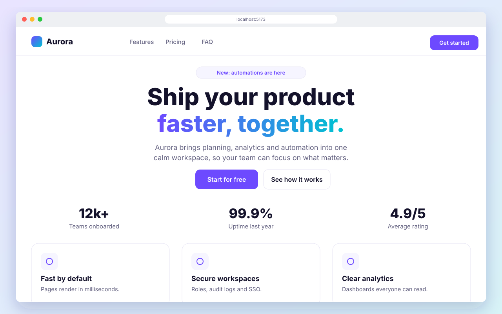

<p align="center">
  
</p>
<p align="center"><sub>Preview: design illustration of the hero section (light theme).</sub></p>

# Aurora: React SaaS Landing Page

A modern, free landing page template built with **React 18**, **TypeScript** and **Vite**. No UI library: just clean sections you can reorder, restyle and reuse.

## Sections

- **Sticky navigation** with anchor links, theme toggle and call to action
- **Hero** with gradient headline, badge and buttons
- **Highlights** row with key numbers
- **Features** grid with icons
- **Testimonials** with ratings
- **Pricing** with a monthly / yearly switch (yearly = two months free) and a highlighted plan
- **FAQ** accordion with proper ARIA and Arrow key navigation
- **Final call to action** and footer

## Details

- Light and dark themes, remembered between visits, no flash on load
- Fully responsive, with reduced motion support
- Accessible: semantic landmarks, focus styles, labelled controls
- Pricing and FAQ logic are plain functions with unit tests
- Zero dependencies beyond React

## Quick start

```bash
git clone https://github.com/lenivalestevao/react-landing-page.git
cd react-landing-page
npm install
npm run dev
```

| Command | What it does |
| --- | --- |
| `npm run build` | Type-check and create a production build in `dist/` |
| `npm run preview` | Serve the production build locally |
| `npm test` | Run the unit tests (Vitest) |
| `npm run typecheck` | TypeScript check only |

## Project structure

```
src/
  App.tsx                 Page layout: nav, hero, features, testimonials, CTA, footer
  styles.css              Design tokens (light and dark) and all styles
  components/
    Pricing.tsx           Plans with monthly / yearly switch
    Faq.tsx               Accessible accordion
    Icon.tsx              Inline SVG icons
  data/content.ts         Features, plans, testimonials and FAQ text
  lib/
    pricing.ts            Yearly price and savings helpers
    faq.ts                Accordion helpers
    lib.test.ts           Unit tests
    theme.ts              Theme hook with persistence
```

## Make it yours

- **Copy and plans**: edit `src/data/content.ts`. Nothing else needs to change.
- **Colors**: change the CSS variables at the top of `src/styles.css`.
- **Brand**: replace "Aurora" in `index.html` and `App.tsx`, and update the `.logo` style.
- **Yearly discount**: change `YEARLY_MONTHS_PAID` in `src/lib/pricing.ts`.

## License

MIT. Free for personal and commercial use.
